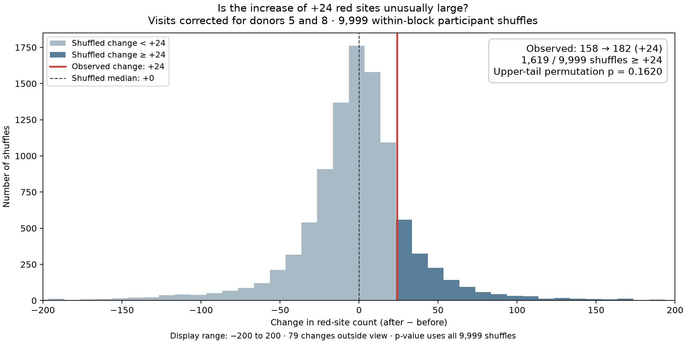

# Figure 1B: is the increase in red-site counts unusual?

This project reconstructs Figure 1B of
[Karbacher et al., DOI 10.1002/mco2.70899](https://onlinelibrary.wiley.com/doi/10.1002/mco2.70899)
and tests the after-minus-before change in the number of highlighted CpG sites.

> **Updated result, 6 November 2026:** Using the author-supplied diet assignments
> and randomization blocks, the observed counts remain **158 before and 182 after
> (+24)**. Of **9,999 shuffles within the supplied blocks**, **1,619** produced
> an increase of at least +24. The one-sided permutation p-value is **0.1620**.

The observed increase is not unusual under this conditional within-block test.
This exploratory result concerns the change in thresholded-site counts. It does
not establish absence of a diet effect, test every individual CpG interaction,
or evaluate the paper's other outcomes.

Read the executed [results notebook](notebooks/figure1b_results.ipynb) or its
[HTML copy](notebooks/figure1b_results.html). **Run All** checks saved results and
renders the explanations; it does not refit thousands of permutations.

## Verified diets and randomization blocks

Max Storz confirmed **0 = vegan diet, 1 = meat-rich diet** and supplied an allocation
workbook. It matches **all 48 participant IDs**, and **all 48 diet assignments agree
with the numeric codes** previously used. The conflicting deposited named-diet
field is retained as source data but is excluded from the current diet assignment.
Observed effects can now be labeled **vegan minus meat-rich**.

The randomization list was created by an external statistician. Planned block
sizes were 13 through observation 52, followed by replacement blocks of 4.
The workbook identifies the following participants in the analyzed subset:

| Supplied block | Planned size | Analyzed vegan | Analyzed meat-rich | Analyzed total |
| --- | ---: | ---: | ---: | ---: |
| normal_1 | 13 | 6 | 4 | 10 |
| normal_2 | 13 | 4 | 6 | 10 |
| normal_3 | 13 | 7 | 6 | 13 |
| normal_4 | 13 | 4 | 7 | 11 |
| replacement_1 | 4 | 2 | 1 | 3 |
| replacement_2 | 4 | 1 | 0 | 1 |
| Total | | 24 | 24 | 48 |

We shuffle within each supplied block and preserve its observed diet counts among
included participants. Participant **57** is the only included member of
`replacement_2`, so that participant's assignment stays fixed. The original and
replacement blocks with the same numerical suffix are distinct. Membership is
read from the workbook, not inferred from sorted IDs.

The [allocation note](docs/randomization_update.md),
[validated participant table](data/randomization/participant_blocks.csv) and
[provenance record](data/randomization/provenance.json) document the update.
The original workbook stays local and is ignored by Git. The minimal CSV contains
all allocation information needed to reproduce the analysis.

## Main result and histogram

A CpG is a measured DNA location. A site is highlighted in red when it passes
**raw two-sided limma p < 0.05 and abs(logFC) > 0.5**. The same thresholds apply
at both visits and in every shuffled fit.



Each entry is one assignment's **after count minus before count**. The red line
marks +24; dark bars contain changes ≥ +24, including ties. The x-axis shows −200
to 200, with the number outside this view noted on the plot. All 9,999 changes
contribute to the p-value, independently of the displayed range and histogram bins.
A [PDF](results/blocked_randomization/diet_code/null_changes.pdf) is available.

The shuffled median is **+0**, with 2.5th and 97.5th percentiles
**-101.05 and +78.00**. These describe shuffled changes; they are not a confidence
interval for the diet effect. The approximate Monte Carlo standard error is
**0.0037**. A separate 9,999-shuffle check with seed 70901 gives **p = 0.1617**.

## How the test works

The analysis covers **812,934 CpGs, 48 participants and two visits per person**.
For each of **9,999 draws with seed 70899**:

1. Keep methylation measurements and the corrected visit assignments fixed.
2. Independently permute diet labels within each supplied block, preserving that
   block's analyzed diet counts and the overall 24/24 totals.
3. Use the **same participant assignment for both visits and every CpG**.
4. Refit the same four diet-by-visit means and re-estimate limma's empirical Bayes
   variance prior across all sites. Apply the same raw-p and effect thresholds.
5. Count red sites at each visit and subtract within that assignment.

```text
D_observed = 182 − 158 = +24
D_b        = C_after,b − C_before,b
p_increase = (1 + number of D_b ≥ 24) / (9999 + 1)
           = (1 + 1619) / 10000
           = 0.1620
```

There are **74,918,844,000** possible assignments conditional on these block counts,
including the observed assignment. Draws are uniform over this space and sampled
with replacement. The +1 correction prevents zero p-values from finite sampling.
This is a **one-sided test of an increase**; the limma tests inside the red-site
rule remain two-sided. Approximately **16.2%** of assignments yield an increase
at least as large under this scheme. This is not the probability that no diet
effect exists.

Each shuffle uses its own baseline count. The test is not conditional on starting
at exactly 158 and does not estimate the probability of the exact pair 158 → 182.
A net increase of 24 can involve sites entering and leaving the red set. More red
sites does not itself imply increased methylation because the rule uses the
absolute effect. The statistic and upper-tail direction were selected during
exploratory review, before these author-supplied corrections and restrictions.

## Model and conditional interpretation

We use the author-confirmed initial **unblocked four diet-by-visit means** model
with limma **3.54.0**, `lmFit`, `contrasts.fit` and default `eBayes`
(`trend=FALSE`, `robust=FALSE`). There are 92 residual degrees of freedom.
All five author-supplied contrasts are included; Figure 1B uses the between-diet
contrast at each visit. The code checks that `decideTests(adjust.method="none",
p.value=0.05, lfc=0.5)` gives exactly the same highlighted sites as our rule.

```text
M     = log2(beta / (1 − beta))
logFC = mean(M in vegan group) − mean(M in meat-rich group), at the same visit
```

The effect is a log2 ratio of geometric mean methylation odds. It is not a
methylation percentage-point change or a ratio of arithmetic mean beta values.
We derive M-values from the public processed beta matrix; the author's original
M-value matrix and full CpG result tables have not been supplied.

limma moderates the variances across CpGs and computes site-level p-values from
moderated t statistics. These differ from the single permutation p-value for the
count change. **No CpG has BH-adjusted p < 0.05** in either observed comparison.

**The allocation blocks restrict shuffling; they are not added to the fitted
model.** This preserves the initial Figure 1B analysis. Randomization blocks are
also distinct from participant correlation blocks in the author's later
age/sex-adjusted `duplicateCorrelation` model, which is outside this reanalysis.

The permutation calculation conditions on the analyzed participants and their
observed diet counts in each block. It requires **joint exchangeability of whole
participant profiles within blocks under the null**, including after selection
into this subset. It preserves within-person and between-CpG dependence.
Equal average changes alone do not justify this exchangeability.

The supplied workbook identifies the included participants' allocations; it does
not reconstruct the full recruitment, replacement and missingness mechanism.
Consequently, this is a conditional test using the supplied restrictions, not a
reconstruction of the trial's unconditional allocation process. Blocking does
not resolve possible selection bias. See the [allocation note](docs/randomization_update.md).

## Visit correction and preserved history

The earlier author clarification identified reversed visit labels for donors 5
and 8 and supplied the initial model. Applying the four explicit changes gives
158/182, resolving the original six-site follow-up discrepancy. The author reports
that the original analysis metadata were correct and the errors occurred during
deposition. The [correction note](docs/annotation_correction.md),
[patch](data/corrections/visit_labels.csv) and
[hash record](data/processed/visit_correction.json) document that step.

The corrected sample table changes only those visits. Measurements, participant
IDs, matrix order and numeric diet assignments remain unchanged. The author also
reported sex-annotation errors and totals of 30 women/18 men; individual corrections
remain unavailable. The archived labels contain 32 women/16 men. Sex is not used
by the initial Figure 1B model.

| Analysis | Before | After | Change | Count-change p |
| --- | ---: | ---: | ---: | ---: |
| Manuscript | 158 | 182 | +24 | Not reported for this added test |
| Original deposited visits, unrestricted | 158 | 176 | +18 | 0.2630 |
| Corrected visits, unrestricted | 158 | 182 | +24 | 0.1881 |
| **Corrected visits, within supplied blocks** | **158** | **182** | **+24** | **0.1620** |

Current outputs are in **`results/blocked_randomization/`**. Both unrestricted
analyses remain in their original directories: `results/corrected_visits/` and
`results/diet_code/`. Their saved counts, figures and audits are preserved.
The same seed samples different assignments after block restrictions are imposed.
The public annotation files were last [checked on 31 October 2026](data/corrections/public_annotation_check.json);
this update uses the author's allocation workbook rather than a new public release.

## Supporting plots and validation

The [volcano figure](results/blocked_randomization/diet_code/figure1b_observed_and_shuffled.png)
shows observed groups on the top row and one shared within-block reassignment on
the bottom row. Both rows show limma p-values. The illustrative seed is **70900**,
giving **152 before and 151 after**; it is separate from the
9,999-shuffle primary run. The [example provenance](results/blocked_randomization/diet_code/shuffled_example/run.json)
records its allocation restrictions and model.

The [visit-specific count histograms](results/blocked_randomization/diet_code/null_counts.png)
provide secondary tests for an excess of red sites at each visit, without an
across-visit adjustment. The notebook also compares the four-cell fit with
separate-visit fits using verified diets. Historical fits based on the conflicting
named-diet field are retained as archival diagnostics and excluded from the
current diet comparison.

**All 20 automated tests pass.** They cover R/limma agreement, numerical edge cases,
participant and matrix alignment, the visit patch, input-file integrity, within-block
count preservation, fixed singleton behavior, invalid allocation rejection and
preservation of the historical unrestricted random sequence.

The [blocked audit](results/blocked_randomization/audit/audit_summary.json) verifies
all 48 diets, explicit block membership, source hashes, every summary field and
all 9,999 assignment restrictions. Independently reconstructed assignments and
factorial-coded R/limma models agree for **11 full-data fits**, including the
observed assignment, extreme changes and changes near the +24 boundary. The
largest observed absolute statistic discrepancy is **2.74e-13**. Observed
per-CpG results match the earlier corrected-visits fit exactly.

The [invariance audit](results/blocked_randomization/audit/invariance_summary.json)
checks explicit residual calculations, group/visit/order symmetries and sample-pair
distances. Distance QC cannot establish biological identity or justify relabeling.

The independent Monte Carlo check uses seed **70901** and the same block restrictions:
**1,616 / 9,999 changes ≥ +24**, giving **p = 0.1617**. Its
[summary](results/blocked_randomization/audit/independent_seed_summary.json) and
[counts](results/blocked_randomization/audit/independent_seed_counts.csv) are reported
separately and are not pooled with or substituted for the primary run.

These checks start with the deposited processed beta matrix. They do not repeat
IDAT normalization or probe filtering and do not evaluate pathway, blood-cell or
epigenetic-clock outcomes. Matching counts does not establish identity with the
author's original CpG-level result tables.

## Reproduce the current analysis

The repository contains the validated allocation CSV, visit patch, annotations,
code, pinned dependencies, summaries, all shuffle count pairs, figures and executed
notebook/HTML. Large matrices and full per-CpG CSV tables are excluded from Git,
as are the original workbook, local environments and private correspondence.

With Python dependencies installed, `make change-test` reproduces the current
p-value from the committed count pairs. To execute every notebook cell, rebuild
the observed per-CpG tables with `make fetch`, `make prepare` and `make limma`.

```bash
uv venv .venv
uv pip sync --python .venv/bin/python requirements-notebook.lock.txt
.venv/bin/python -m ipykernel install --prefix .venv --name vegandiet --display-name 'Python (vegandiet)'
```

The saved fits use R 4.3.3 and limma 3.54.0 (the paper reports R 4.2.3).
`scripts/run_r.sh` uses project-local R under `.tools/` when available, otherwise
an installed `Rscript`. Install the included limma archive in R:

```r
dir.create(".tools/r-library", recursive=TRUE, showWarnings=FALSE)
install.packages("data/reference/limma_3.54.0.tar.gz", repos=NULL,
                 type="source", lib=".tools/r-library")
```

Run from the project root:

```bash
make fetch
make prepare
make test
make limma
make permutation PERMUTATIONS=9999 SEED=70899
make plots EXAMPLE_SEED=70900
# The audit compares full observed tables with the archived corrected fit.
# Rebuild those archived tables if they are not already available locally:
bash scripts/run_r.sh scripts/figure1b_limma.R diet_code '' corrected_visits
make audit
OPENBLAS_NUM_THREADS=4 OMP_NUM_THREADS=4 .venv/bin/python scripts/audit_results.py --scenario blocked_randomization --independent-seed 70901
make execute-notebook
```

`make randomization` re-extracts the original author workbook when it is available
locally; the committed CSV suffices for all other commands. `make corrections`
rebuilds only the corrected sample table. `make all` runs through figure generation;
audits and notebook execution are separate. `make plots` reuses the last selected
example seed unless another is supplied. Allow several GB of RAM/disk and several
minutes per complete permutation run.

Analysis commands default to **`blocked_randomization`**. Explicit
`SCENARIO=corrected_visits` or `SCENARIO=deposited` selects a historical unrestricted
analysis and can overwrite its outputs. `make audit-deposited` repeats the original
source/replay audit. The current notebook reads only the blocked analysis, with
historical summaries included for comparison. Original audit records refer to
the code versions and scenarios recorded when those audits ran.

If public input contents change, fetching fails against pinned hashes. Reconcile
a new public release with the documented local corrections before updating inputs.

Main result files:

| File | Contents |
| --- | --- |
| [change_test_summary.csv](results/blocked_randomization/diet_code/change_test_summary.csv) | Observed +24, shuffled quantiles, p-value and Monte Carlo SE |
| [permutation_null_counts.csv](results/blocked_randomization/diet_code/permutation_null_counts.csv) | All 9,999 paired before/after counts |
| [permutation_null_changes.csv](results/blocked_randomization/diet_code/permutation_null_changes.csv) | Differences and assignment numbers |
| [permutation_run.json](results/blocked_randomization/diet_code/permutation_run.json) | Allocation restrictions, hashes, seed, model and thresholds |
| [scenario_comparison.csv](results/blocked_randomization/audit/scenario_comparison.csv) | Current and historical results side by side |

References: [limma guide](https://bioconductor.org/packages/release/bioc/vignettes/limma/inst/doc/usersguide.pdf),
[minfi scales](https://bioconductor.org/packages/release/bioc/manuals/minfi/man/minfi.pdf),
[Monte Carlo permutation p-values](https://arxiv.org/abs/1603.05766),
[exchangeability](https://pmc.ncbi.nlm.nih.gov/articles/PMC4010955/),
and [original trial](https://doi.org/10.3390/microorganisms9040727).
