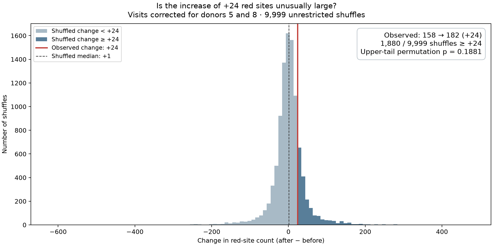

# Figure 1B: is the increase in red-site counts unusual?

This project reconstructs Figure 1B of
[Karbacher et al., DOI 10.1002/mco2.70899](https://onlinelibrary.wiley.com/doi/10.1002/mco2.70899)
and tests the after-minus-before change in the number of highlighted CpG sites
using joint participant-label shuffles.

> **Updated result, 31 October 2026:** After correcting the reversed visit labels
> for donors 5 and 8, the reconstruction gives **158 sites before and 182 after
> (+24)**, matching the published counts. Of **9,999 newly fitted shuffles**,
> **1,880** produced an increase of at least +24. The one-sided
> permutation p-value is **0.1881**.

The increase is not unusual under this unrestricted shuffling scheme. This is an
exploratory count-change diagnostic, conditional on the retained numeric grouping;
it does not establish absence of a diet effect or an error in individual published
CpG p-values. Verified diet assignments and original allocation blocks remain
unavailable.

Read the executed [results notebook](notebooks/figure1b_results.ipynb) or its
[HTML copy](notebooks/figure1b_results.html). **Run All** checks saved results and
renders explanations; it does not refit thousands of permutations.

## What changed and what is preserved

An author clarified that the deposited time labels for donors 5 and 8 were reversed,
and supplied the initial limma model. Applying those four explicit label changes
resolves the six-site follow-up count discrepancy. The author reports that the
metadata used for the publication were correct and that the errors arose during
deposition. We have not received the complete corrected sample sheet.

The [correction note](docs/annotation_correction.md) records the four array IDs,
provenance, model clarification and remaining limitations. The
[patch](data/corrections/visit_labels.csv) produces
[samples_corrected_visits.csv](data/processed/samples_corrected_visits.csv), with
[input/output hashes](data/processed/visit_correction.json). Only the time field
changes: measurements, participant IDs, matrix order, numeric grouping and sex
annotations are retained. Individual sex corrections were not supplied; sex is
not used by the initial Figure 1B model.

The public annotation files were still identical to our archived copies when
[checked on 31 October 2026](data/corrections/public_annotation_check.json).
This is therefore a documented **local correction**, not an updated public release.

| Analysis | Before | After | Change | Count-change p |
| --- | ---: | ---: | ---: | ---: |
| Manuscript | 158 | 182 | +24 | Not reported for this added test |
| Original deposited visits | 158 | 176 | +18 | 0.2630 |
| **Corrected visits, current analysis** | **158** | **182** | **+24** | **0.1881** |

Current outputs are in **`results/corrected_visits/`**. Original outputs in
`results/diet_code/`, `results/diet_named/` and `results/audit/` remain unchanged.
The previous README and notebook are available in
[commit b7cccf8](https://github.com/pbenner/diet-methylation-reanalysis/tree/b7cccf8cf00b811d666af29c5194aeece418684f).
The historical p-value 0.2630 refers to the old visit labels and +18 statistic.

## Main result and histogram

A CpG is a measured DNA location. A site is highlighted in red when its between-group
comparison passes **raw two-sided limma p < 0.05 and abs(logFC) > 0.5**. These
thresholds are identical at both visits and in every shuffled fit.



Each histogram entry is one assignment's **after count minus before count**. The
red line marks +24; dark bars contain changes ≥ +24, including ties. All 9,999
changes are included, and the p-value is computed from exact counts independently
of histogram bins. A [PDF](results/corrected_visits/diet_code/null_changes.pdf) is available.

The shuffled median is **+1**, with 2.5th and 97.5th percentiles
**-91.05 and +95**. These describe the shuffled distribution,
not a confidence interval for a diet effect. The approximate Monte Carlo standard
error is **0.0039**.

## How the permutation test works

The analysis covers **812,934 CpGs, 48 participants and two visits per person**.
For each of **9,999 shuffles with seed 70899**:

1. Keep methylation measurements and the corrected visit assignments fixed.
2. Randomly reassign participants to two groups of 24.
3. Use the **same assignment for both visits and every CpG**.
4. Refit the four group-by-visit means and re-estimate the empirical Bayes variance
   prior across all sites. Apply the same raw-p and effect thresholds.
5. Count red sites at each visit, then subtract within that assignment.

```text
D_observed = 182 − 158 = +24
D_b        = C_after,b − C_before,b
p_increase = (1 + number of D_b ≥ 24) / (9999 + 1)
           = (1 + 1880) / 10000
           = 0.1881
```

The +1 correction includes the observed assignment in the Monte Carlo comparison
and prevents zero p-values from finite sampling. This is a **one-sided test of an
increase**; the limma tests defining red sites remain two-sided. Approximately
18.8% of assignments yield an increase at least as large. This is not the
probability that the null hypothesis is true or that there is no diet effect.

Each shuffle uses its own before count. The test is not conditional on starting
at exactly 158, and it does not estimate the probability of exactly 158 → 182.
A net increase of 24 can involve sites entering and leaving the red set. Because
the red rule uses the absolute effect, more red sites does not itself mean higher
methylation.

The current run repeats **every shuffled fit** with corrected visits; it does not
reuse the old counts with a new cutoff. Using the same seed and numeric grouping
preserves the participant assignments across the historical and current runs.
The statistic and upper-tail direction were chosen during exploratory review,
before this correction, rather than before examining any data.

## Model, effect scale and assumptions

**limma** is an R/Bioconductor package for linear models across many features. Its
empirical Bayes moderation uses information across CpGs to stabilize site-specific
variance estimates. We use limma **3.54.0** with default `eBayes` settings:
`trend=FALSE`, `robust=FALSE`.

```text
M     = log2(beta / (1 − beta))
logFC = mean(M in code 0) − mean(M in code 1), at the same visit
```

The effect is a difference in mean M-values: a log2 ratio of geometric mean
methylation odds. It is not a methylation percentage-point change or a ratio of
arithmetic mean beta values. We derive M-values from the public processed matrix;
the author's original M-value matrix and site-by-site results are not yet available.

The author confirmed the initial **unblocked four group-by-time model** and supplied
five contrasts: within-group visit changes, between-group differences at each visit,
and their interaction. Our R script includes these contrasts and checks that
`decideTests(adjust.method="none", p.value=0.05, lfc=0.5)` gives exactly the same red
sites as our threshold rule. The two between-group contrasts are used for Figure 1B.
There are 92 residual degrees of freedom, pooling residual variance across visits.
The author's later age/sex-adjusted model with participant blocking is outside this
analysis.

The site-level p-values come from moderated t statistics and their reference t
distribution. They are different from the single permutation p-value for the count
change. **No numeric-group CpGs have BH-adjusted p < 0.05** in either corrected visit
comparison. Red points are thresholded raw-p results, not genome-wide discoveries.

The shuffles assume **joint exchangeability of whole participant profiles**,
conditional on group sizes. They preserve both within-person and between-CpG
dependence. Equal average changes alone do not justify this assumption, and
subtracting counts does not make this a general test of a diet-by-time interaction.

The [original trial](https://doi.org/10.3390/microorganisms9040727) reports block
randomization with block size 13. Participant-to-block membership and the subset's
allocation procedure are unavailable. No blocks are inferred from participant IDs.
Consequently this remains an **unrestricted diagnostic**, not an exact test under
the original blocked allocation.

## Group labels and other remaining questions

The archived public annotations contain conflicting group fields:

| Numeric code | Named vegan | Named meat-rich | Total |
| --- | ---: | ---: | ---: |
| 0 | 11 | 13 | 24 |
| 1 | 15 | 9 | 24 |
| Total | 26 | 22 | 48 |

The author confirms that the analyzed groups should contain 24 participants each.
This supports checking the numeric grouping, but does not independently verify
its participant assignments or the correspondence of codes to diet names. Effects
are therefore still labeled **code 0 minus code 1**. Matching both published counts
does not verify site identities or diet mapping.

The author also confirms sex-annotation errors and totals of 30 women/18 men.
The archived labels contain 32 women/16 men. We do not infer individual corrections.
The complete corrected sample sheet, verified diet mapping, allocation blocks and
original CpG tables would resolve the remaining reproduction questions.

## Supporting plots, sensitivity and validation

The [volcano figure](results/corrected_visits/diet_code/figure1b_observed_and_shuffled.png)
shows observed groups on the top row and one shared shuffled assignment on the
bottom row. Both rows use limma p-values on the vertical axes. Count-test p-values
are not placed on the observed volcano row. The example seed is 70900; its
[counts and provenance](results/corrected_visits/diet_code/shuffled_example/run.json)
are separate from the primary seed 70899.

Separate visit-specific count diagnostics appear in the
[count histograms](results/corrected_visits/diet_code/null_counts.png) and
[count summary](results/corrected_visits/diet_code/count_test_summary.csv). They test
an excess of red sites at each visit, without an across-visit adjustment.
Named-label and separate-visit sensitivity fits are displayed in the notebook;
they do not validate a named diet effect while the annotations conflict.

**Fourteen automated tests pass**, including comparisons with R limma, correction
identity checks, rejection of double application, sample-order checks, tail ties,
the +1 correction, and download integrity. Before the permutation run, every observed
effect, moderated t statistic and p-value was checked against the full R fit.

The [corrected audit](results/corrected_visits/audit/audit_summary.json) verifies the
patch, unchanged source files and beta matrix, all summary fields, and selected
full-data shuffles against independent factorial-coded R fits. All **11 R fits**
agree on the counts; the largest observed absolute statistic discrepancy is below
2.75 × 10⁻¹³. The correction changes the paired counts for **9,984 of 9,999**
assignments, confirming that the old null distribution must be refitted. The
[invariance audit](results/corrected_visits/audit/invariance_summary.json) checks
explicit residual calculations, group/visit/order symmetries, cutoff distances and
descriptive sample-pair distances. Distance QC cannot establish biological identity
or justify relabeling participants.

The separate Monte Carlo check uses seed **70901** with corrected visits and gives
**p = 0.1859** (1,858 of 9,999 changes ≥ +24), close to the primary 0.1881. Its
[result](results/corrected_visits/audit/independent_seed_summary.json) and
[paired counts](results/corrected_visits/audit/independent_seed_counts.csv) are
reported separately in the notebook and are not pooled with the main run.
Historical audits in `results/audit/` refer to the original annotation scenario and
code version; their evidence is retained rather than rewritten.

These checks start with the deposited processed beta matrix. They do not repeat
IDAT normalization or probe filtering, and do not evaluate the paper's pathway,
blood-cell or epigenetic-clock analyses.

## Reproduce the current analysis

The repository includes code, pinned dependencies, sample annotations, the explicit
correction, hashes, executed notebook/HTML, figures, summaries and paired shuffle
counts for both scenarios. Large matrices and full `*_limma.csv.gz` tables are
excluded from Git. Local environments, assistant state and private correspondence
are also excluded.

You can read the saved notebook or HTML immediately after cloning. With Python
dependencies installed, `make change-test` reproduces the current p-value directly
from the included count pairs. To execute every notebook cell, rebuild the full
per-CpG tables using `make fetch`, `make prepare` and `make limma` first.

```bash
uv venv .venv
uv pip sync --python .venv/bin/python requirements-notebook.lock.txt
.venv/bin/python -m ipykernel install --prefix .venv --name vegandiet --display-name 'Python (vegandiet)'
```

The saved fits use R 4.3.3 and limma 3.54.0 (the paper reports R 4.2.3).
`scripts/run_r.sh` uses project-local R under `.tools/` when available, otherwise an
installed `Rscript`. With R installed, run this from the repository root in R:

```r
dir.create(".tools/r-library", recursive=TRUE, showWarnings=FALSE)
install.packages("data/reference/limma_3.54.0.tar.gz", repos=NULL,
                 type="source", lib=".tools/r-library")
```

Then run from the project root:

```bash
make fetch          # uses stable download URLs and verifies pinned SHA-256 hashes
make prepare        # builds original data, then applies the explicit visit patch
make test
make limma          # current corrected-visits model and sensitivities
make permutation PERMUTATIONS=9999 SEED=70899
make plots EXAMPLE_SEED=70900
make audit
OPENBLAS_NUM_THREADS=4 OMP_NUM_THREADS=4 .venv/bin/python scripts/audit_results.py --scenario corrected_visits --independent-seed 70901
make execute-notebook
```

If the prepared matrix already exists, `make corrections` only rebuilds the corrected
sample table. `make all` runs through figure generation; audit and notebook execution
are separate. `make notebook` opens Jupyter Lab. `make plots` reuses the last example
seed unless another is supplied. Allow several GB of RAM/disk and several minutes
for each complete permutation run.

**Scenario selection is explicit:** analysis commands default to `corrected_visits`.
To intentionally rerun a historical step use, for example,
`make permutation SCENARIO=deposited SEED=70899`. This overwrites that historical
scenario's generated outputs. `make audit-deposited` repeats the original source
and replay audit. The current notebook always reads `results/corrected_visits/`.

If the public input contents change, fetching fails against the archived hashes
instead of silently mixing annotation versions. Reconcile a new public release
with the documented local correction before updating those inputs.

Main result files:

| File | Contents |
| --- | --- |
| [change_test_summary.csv](results/corrected_visits/diet_code/change_test_summary.csv) | Observed +24, shuffled quantiles, p-value and Monte Carlo SE |
| [permutation_null_counts.csv](results/corrected_visits/diet_code/permutation_null_counts.csv) | All 9,999 newly fitted before/after pairs |
| [permutation_null_changes.csv](results/corrected_visits/diet_code/permutation_null_changes.csv) | Paired differences and assignment numbers |
| [permutation_run.json](results/corrected_visits/diet_code/permutation_run.json) | Scenario, sample-table hash, seed, model and thresholds |
| [scenario_comparison.csv](results/corrected_visits/audit/scenario_comparison.csv) | Historical and corrected results side by side |

Statistical references: [limma guide](https://bioconductor.org/packages/release/bioc/vignettes/limma/inst/doc/usersguide.pdf),
[minfi scales](https://bioconductor.org/packages/release/bioc/manuals/minfi/man/minfi.pdf),
[Monte Carlo permutation p-values](https://arxiv.org/abs/1603.05766), and
[exchangeability](https://pmc.ncbi.nlm.nih.gov/articles/PMC4010955/).
