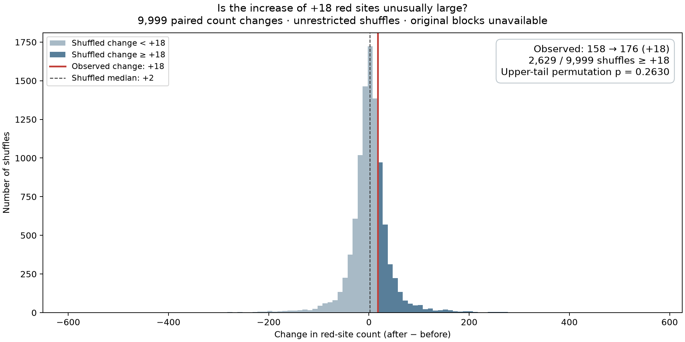

# Figure 1B: is the increase in red-site counts unusual?

This project reconstructs the methylation comparisons in Figure 1B of
[Karbacher et al., DOI 10.1002/mco2.70899](https://onlinelibrary.wiley.com/doi/10.1002/mco2.70899).
The main question is whether the increase from **158 red sites before to 176 after
(+18)** is unusually large when participants are randomly reassigned to groups.

> **Main result for our candidate reconstruction:** Among 9,999 participant-label shuffles preserving each person's
> before/after samples, 2,629 produced an increase of at least +18 red sites.
> The one-sided permutation p-value is **0.2630**. The observed increase is therefore
> not unusual under this unrestricted shuffling scheme.

This conclusion concerns the increase in the number of sites passing the figure's
thresholds. It does not establish that the diets are equivalent or that methylation
is unaffected. The reconstruction is provisional: the public diet annotations
conflict, the original randomization blocks are unavailable, and the authors'
Figure 1B analysis code is not included in the deposit.

Open the executed [results notebook](notebooks/figure1b_results.ipynb) or its
[HTML reading copy](notebooks/figure1b_results.html) for the calculations, histogram,
volcano plots, annotation audit, and an editable individual-CpG example. Running all
notebook cells reads and checks saved results; it does not repeat thousands of model fits.

## Main result and histogram

A CpG site is a measured DNA location. Here, a site is **red** when its between-group
comparison meets both rules: **raw limma p < 0.05 and abs(logFC) > 0.5**. The same
rules apply before and after, and to every shuffled grouping. The effect scale and
limma calculation are explained below.

| Analysis | Before | After | After − before |
| --- | ---: | ---: | ---: |
| Manuscript | 158 | 182 | +24 |
| Numeric-label reconstruction used here | 158 | 176 | **+18** |

We test the reconstructed change of +18 so that the observed and shuffled counts
come from the same analysis. The baseline count matches the paper; the follow-up
count differs by six. Matching a count does not verify the identities of the sites
or the meaning of the group codes.



The horizontal axis is the **after count minus the before count for one shuffle**;
the vertical axis is the number of shuffles in each interval. Positive values mean
more red sites after; negative values mean fewer. The red line marks the observed
+18. Dark bars contain changes of +18 or more, including ties. All 9,999 changes
are included. The p-value uses the exact counts, so it does not depend on histogram
bin width. A [PDF copy](results/diet_code/null_changes.pdf) is also available.

The shuffled median change is **+2**, and the 2.5th and 97.5th percentiles are
**−88 and +94**. These describe the shuffled distribution; they are not a confidence
interval for a diet effect. The approximate Monte Carlo standard error of the
p-value is **0.0044**, reflecting the finite number of sampled assignments.

## How the change test works

The analysis includes **812,934 CpGs, 48 participants, and two visits per person**.
The saved run uses **9,999 shuffles with seed 70899**. For each shuffle:

1. Keep all methylation measurements fixed.
2. Randomly reassign the 48 participants to two groups of 24.
3. Use the **same assignment for both visits and every CpG**. Each person's paired
   samples stay together, and relationships between CpGs are preserved.
4. Refit the same four group-by-visit means and re-estimate limma's empirical Bayes
   variance prior across all sites. Apply the same raw-p and effect thresholds.
5. Count red sites before and after, then subtract **within that assignment**.

Writing these two counts as `C_before` and `C_after`, the statistic is:

```text
D_observed = 176 − 158 = +18
D_b        = C_after,b − C_before,b          for shuffle b

p_increase = (1 + number of D_b ≥ D_observed) / (B + 1)
           = (1 + 2629) / (9999 + 1)
           = 0.2630
```

The +1 correction includes the observed assignment in the Monte Carlo comparison
and prevents a zero p-value from a finite sample of shuffles. Ties are included.
This is a **one-sided test of an increase**: decreases, even large ones, are not
in its upper tail. The limma tests defining which sites are red remain two-sided.
Testing unusually large count changes in either direction would be a different question.

About **26.3%** of sampled assignments produced an increase at least this large.
That is the relevant tail probability under the stated shuffling scheme. It is
not the probability that the null hypothesis is true or that there is no diet effect.

Each shuffle has its **own before count**. We do not condition on that count being
158, and we do not estimate the probability of exactly the pair 158 → 176. We also
do not shuffle visits separately or subtract counts from different assignments.
A net increase of 18 can reflect sites entering and leaving the red set; it need
not mean that exactly 18 new sites became red. Because the red rule uses the absolute
effect, a larger red count does not itself mean higher methylation.

The 9,999 before/after count pairs were already saved by the full model-fitting run.
The change test reuses those paired rows without any new shuffles. Its code is in
[scripts/change_test.py](scripts/change_test.py). The statistic and upper-tail
direction were chosen during exploratory review, rather than specified before
examining the results.

## What the shuffling assumes

The calculation assumes that whole participant methylation profiles can be
reassigned between groups while retaining group sizes of 24/24. This is the
**unrestricted exchangeability assumption**: under the reference model, the observed
assignment is comparable with these shuffled assignments. It preserves dependence
between CpGs and visits and does not require the CpGs to be independent.
The null applies to whole before/after profiles. Equal average changes between
groups alone are insufficient to justify these shuffles. Subtracting the baseline
red count does not make this a general test of a diet-by-time interaction.

The [original trial methods](https://doi.org/10.3390/microorganisms9040727) report
block randomization with block size 13. The public methylation annotations do not
supply participant-to-block membership. No blocks are inferred from participant
IDs or sample order. Consequently, this is an **unrestricted diagnostic**, not an
exact randomization test under the documented trial allocation.

Verified diet assignments, block membership, the allocation procedure for the
48-person methylation subset, and the authors' Figure 1B script are needed for an
exact reproduction. The current test evaluates a change in thresholded-site counts;
it neither identifies individual diet effects nor tests a diet-by-time interaction
at individual CpGs. A large p-value does not establish absence of such effects.

## What limma and the site-level p-values mean

**limma** is an R/Bioconductor package for fitting linear models to many measured
features. Here, each feature is a CpG. It estimates the group difference at each
site and uses **empirical Bayes variance moderation**: information across sites
helps stabilize each site's variance estimate.

The candidate model transforms each beta value, a methylation measurement between
0 and 1, to an M-value:

```text
M     = log2(beta / (1 − beta))
logFC = mean(M in code 0) − mean(M in code 1)    at the same visit
```

Thus `logFC` is a difference in mean M-values, or a log2 ratio of geometric mean
methylation odds. It is not a change in methylation percentage points or the log2
ratio of arithmetic mean beta values. M-values are an explicit reconstruction
assumption; the figure label alone does not establish the authors' input scale.
See the [minfi reference](https://bioconductor.org/packages/release/bioc/manuals/minfi/man/minfi.pdf)
for the beta and M scales.

The model fits four means: two groups at each of two visits. It compares code 0
with code 1 separately before and after, pooling residual variance across visits.
There are 92 residual degrees of freedom. We use limma 3.54.0 with
`eBayes(trend=FALSE, robust=FALSE)` and no participant blocking. Each site receives
a moderated t statistic, its fitted difference divided by its moderated standard
error. Its raw two-sided p-value is the probability of a t statistic at least as
large in absolute value under limma's reference t distribution, with degrees of
freedom incorporating the variance moderation. These are model-based p-values.
See the [limma guide](https://bioconductor.org/packages/release/bioc/vignettes/limma/inst/doc/usersguide.pdf).

The red-site rule uses these **raw** limma p-values. Benjamini–Hochberg (BH)
adjustments are also computed across all CpGs at each visit, before applying the
effect threshold. **No sites have BH-adjusted p < 0.05 in the numeric grouping.**
Red points therefore represent the figure's thresholded comparisons, not a set of
genome-wide discoveries after multiple-testing correction.

The permutation p-value of **0.2630** is a separate calculation for the **change
in red-site counts**. It does not replace the limma p-values for individual sites.
The shuffles preserve each person's two visits, but the underlying limma model
does not explicitly model their correlation. The later subject-blocked analysis
mentioned in the paper is not reconstructed here.

## Supporting plots and checks

The [volcano figure](results/diet_code/figure1b_observed_and_shuffled.png) has observed
groups in the first row and one shuffled grouping in the second. Every point is a
CpG; the axes show its fitted M-value difference and `−log10(raw limma p)`. Both rows
use the same model and highlighting thresholds. The lower row contains limma
p-values fitted to that one assignment; the histogram above uses all 9,999 assignments.

The current illustrated assignment uses **seed 70900** and gives **227 before and
202 after (−25)**. It is the first assignment generated from that seed, selected
before fitting. Its seed is independent of the full run's seed 70899. The first
assignment from the full run gave 381 and 340 (−41); that earlier example and its
plot are archived. A single shuffled grouping is a visual check, while the full
distribution supplies the main result. After changing the example seed, consult
[its saved metadata](results/diet_code/shuffled_example/run.json) for the current counts.

For context, separate upper-tail tests of the count at each visit give:

| Visit | Observed red sites | Shuffled median | Shuffles with count ≥ observed | Count p |
| --- | ---: | ---: | ---: | ---: |
| Before | 158 | 200 | 9,334 / 9,999 | 0.9335 |
| After | 176 | 203 | 8,072 / 9,999 | 0.8073 |

These secondary diagnostics use `(1 + extreme counts) / (B + 1)` and are displayed
in the [count histograms](results/diet_code/null_counts.png). They test an excess
at each visit, rather than the increase between visits. Their p-values are reported
separately without an across-visit adjustment.

Fitting visits separately gives 160 and 177 red sites. Using the conflicting named
diet annotations in the four-mean model gives 668 and 502, with one BH-adjusted
p-value below 0.05 at each visit. These are sensitivity analyses of model and label
choices, not additional validated diet findings.

## Data and unresolved group labels

The public deposit is [E-MTAB-17025](https://www.ebi.ac.uk/biostudies/arrayexpress/studies/E-MTAB-17025).
The processed `b_values4.txt` file is 1,494,040,132 bytes. Its separator is the
literal string `/t`, not a tab. [prepare_data.py](scripts/prepare_data.py) validates
the entire matrix, matches array IDs, collapses red/green annotation rows, checks
participant pairing, and writes a float64 binary matrix. Missing, nonfinite or
out-of-range values cause a failure rather than silent dropping or imputation.
File hashes are recorded in `data/raw/manifest.json` and `data/processed/audit.json`.

The deposited numeric and named diet fields give the following participant counts:

| Numeric diet code | Named vegan | Named meat-rich | Total |
| --- | ---: | ---: | ---: |
| 0 | 11 | 13 | 24 |
| 1 | 15 | 9 | 24 |
| Total | 26 | 22 | 48 |

Both fields remain constant within each person's two visits, but they do not encode
the same assignment. The main analysis uses **code 0 minus code 1**, without
translating the codes into diet names. The named groups are a separate sensitivity
analysis, vegan minus meat-rich. No grouping is chosen by whether it recovers the
published count. These unresolved labels limit interpretation of all results.

There is also a discrepancy in the reported sex composition. The deposited
annotations contain **16 men and 32 women**, with **8 men and 16 women in each
numeric group**. Table 1 of the paper reports **7 men/17 women in the vegan group
and 11 men/13 women in the meat-rich group** (18 men in total). Relabeling the
numeric groups cannot resolve this difference in totals. The current public
annotation files match our downloaded copies, as recorded in
[the metadata verification](results/audit/public_metadata_verification.json).
This warrants clarification about the annotations and analyzed cohort; it does
not establish which source is incorrect. See [Table 1](https://onlinelibrary.wiley.com/doi/10.1002/mco2.70899)
and the [computed public sex counts](results/audit/public_sex_counts.csv).

As an additional diagnostic, we compared every pair of arrays using the root mean
squared difference across all deposited beta values. For 46/48 baseline arrays,
the closest follow-up array belongs to the annotated participant; in the reverse
direction this holds for 45/48 follow-up arrays. The baseline exceptions are IDs
29 and 37; the reverse comparison also flags ID 8. These distances cannot establish
sample identity or a swap. The [paper's quality-control description](https://pmc.ncbi.nlm.nih.gov/articles/PMC13430503/)
already reports two exceptions to before/after hierarchical clustering and states
that SNP-based checks agreed with the cohort. Our distance calculation is different
from that clustering, so the exceptions cannot be equated. We retain every deposited
pair and recommend requesting the sample-to-participant mapping and SNP-based QC.
The complete diagnostic is in [pair_distance_check.csv](results/audit/pair_distance_check.csv).

## Reproduce and inspect the results

The Git repository includes the analysis code, pinned dependencies, tests, public
sample annotations, data hashes, executed notebook and HTML, figures, summaries,
and all 9,999 paired shuffle counts. The preserved limma source archive includes
its original license. Local environments, caches, temporary files and assistant
state are excluded.

The large source methylation matrix, prepared binary matrix, and full per-CpG
`*_limma.csv.gz` tables are also excluded from Git because they can be downloaded
or regenerated. You can read the saved notebook outputs or HTML immediately after
cloning. With Python dependencies installed, `make change-test` reproduces the
main p-value directly from the included counts, without those large files.

To execute **every** notebook cell after a fresh clone, first set up Python and R
as described below, then run `make fetch`, `make prepare`, and `make limma` to
rebuild the full tables used by the individual-CpG example. `make plots` also
requires those files and will rebuild the illustrated shuffled fit if needed.
The existing 9,999 shuffle counts can be reused; a full permutation rerun is
only needed when regenerating the entire analysis.

Run commands from the project root. In the existing environment, `make notebook`
opens the notebook. To regenerate the summaries and figures from saved shuffles,
then refresh the executed notebook and HTML copy:

```bash
make plots
make execute-notebook
```

`make plots` runs both `make change-test` and `make count-test`, ensures that the
single shuffled example is available, and exports figures. The two summary targets
can also be run individually; neither generates new shuffles. Notebook execution
checks the change calculation against the saved paired rows and summary.

To change only the illustrated assignment in the volcano figure:

```bash
make plots EXAMPLE_SEED=70900  # replace with another integer for a different example
make execute-notebook
```

Later plot builds reuse the selected example seed unless another is supplied.
This leaves the 9,999-shuffle change test and its seed unchanged. The example fit is
reused when its inputs match; `.venv/bin/python scripts/shuffled_example.py --force`
forces recalculation.

For a fresh Python environment with notebook support:

```bash
uv venv .venv
uv pip sync --python .venv/bin/python requirements-notebook.lock.txt
.venv/bin/python -m ipykernel install --prefix .venv --name vegandiet --display-name 'Python (vegandiet)'
```

The optional `requirements.lock.txt` installs only the scientific dependencies;
syncing it removes the notebook dependencies. The saved R fits used **R 4.3.3 and
limma 3.54.0**; the paper reports R 4.2.3. The project-local R runtime is under
`.tools/`; [scripts/run_r.sh](scripts/run_r.sh) uses it when present and otherwise
calls an installed `Rscript`. With R installed, the preserved limma source can be
installed into the project library by running the following in R from the project root:

```r
dir.create(".tools/r-library", recursive = TRUE, showWarnings = FALSE)
install.packages("data/reference/limma_3.54.0.tar.gz",
                 repos = NULL, type = "source", lib = ".tools/r-library")
```

To rebuild the analysis, including all shuffled fits:

```bash
make fetch          # 1.49 GB processed matrix; raw IDAT files are not needed
make prepare        # validate data and participant alignment
make test           # numerical reference, pairing, and tail-count checks
make limma          # numeric and named annotation scenarios
make permutation PERMUTATIONS=9999 SEED=70899
make plots
make execute-notebook
```

`make all` runs the pipeline through figure generation; run `make execute-notebook`
afterwards to refresh the notebook and HTML. Allow several GB of RAM and disk
space. Each shuffle covers every CpG, and runtime increases with the shuffle count.
Rebuilding an analysis replaces its generated outputs. Changing the full run's
seed can slightly change the estimated p-value through Monte Carlo sampling.

## Validation and saved files

The follow-up audit checks the calculation separately from its interpretation.
It found no discrepancy affecting the saved **158 → 176, p = 0.2630** result:

- All **78,041,664 deposited beta values** match the prepared binary matrix exactly,
  including all CpG IDs and sample-column mappings. Source-file hashes match the
  manifest, and both visits carry the same participant labels.
- An independent R implementation fits **uncentered M-values with an intercept,
  diet, visit, and interaction**, rather than the production four-cell coding.
  Its observed effects, moderated t statistics, raw p-values and BH-adjusted
  p-values agree with the saved fit to within **2.5 × 10⁻¹³** in absolute value.
- **Eleven full-data R fits**—the observed grouping and ten saved shuffles—give
  identical red-site counts. The checks include the first and last assignments,
  large positive/negative changes, and changes of +17, +18, and +19 around the
  upper-tail cutoff.
- A complete replay of **all 9,999 shuffles** reproduces every paired count exactly.
  The original saved result files are retained unchanged.
- All **ten automated tests** pass. These also compare every assignment in a
  small paired experiment with R limma and check tail ties, the +1 correction,
  participant alignment and deterministic threaded calculations. Added tests
  check constant, zero and widely varying residual variances against R and ensure
  that the summary audit rejects inconsistent counts and shuffle identifiers.
- Independently recomputed summaries match all saved count/change fields and
  shuffle identifiers. A fit using explicit within-cell residuals matches limma;
  swapping group names, reversing visits, and reordering participants produce
  exactly the expected counts. Numerical discrepancies are below 3 × 10⁻¹⁵.
- No observed site lies close enough to a cutoff for the numerical differences
  between our verified implementations to change its classification. This does
  not explain the difference from the authors' unspecified implementation.
- A **separate 9,999-shuffle run with seed 70901** gives 2,623 changes ≥ +18 and
  **p = 0.2624**, compared with 0.2630 in the original run (Monte Carlo SE about
  0.0044 in each). The seed was selected before this check was fitted. This checks
  Monte Carlo stability; it does not validate the unknown diet labels or original
  model. The runs are reported separately, without replacing or pooling results.

The code review found and fixed one alignment weakness: `prepare_matrices` used
matrix-column indices as metadata-row positions when retrieving group labels.
Reordering metadata independently could therefore change labels incorrectly.
Labels are now aligned explicitly by participant and visit, with checks for a
one-to-one matrix-column mapping. A regression test covers metadata reordering.
The production run uses metadata in matrix-column order; the complete replay
after this fix confirms that its results are unchanged.

The machine-readable evidence is in [audit_summary.json](results/audit/audit_summary.json),
[independent_limma_counts.csv](results/audit/independent_limma_counts.csv), and
[full_replay_summary.json](results/audit/full_replay_summary.json). With the full
local data and R fits available, run `make test` and `make audit` to repeat the
checks. The independent R audit is implemented in
[audit_limma.R](scripts/audit_limma.R); [audit_results.py](scripts/audit_results.py)
checks the source data and orchestrates the fits and isolated replay.
[audit_invariants.py](scripts/audit_invariants.py) verifies summaries, model
symmetries, cutoff distances and sample distances; its evidence is saved in
[invariance_summary.json](results/audit/invariance_summary.json).
The additional Monte Carlo result and all its paired counts are in
[independent_seed_summary.json](results/audit/independent_seed_summary.json) and
[independent_seed_counts.csv](results/audit/independent_seed_counts.csv). Repeat
that separate check with:

```bash
OPENBLAS_NUM_THREADS=4 OMP_NUM_THREADS=4 .venv/bin/python scripts/audit_results.py --independent-seed 70901
```

These checks
start from the deposited processed beta matrix; they do not independently repeat
the original IDAT normalization or probe filtering.

**Scope of the claim when contacting the authors:** the value 0.2630 is our
additional test of the reconstructed **count increase**, conditional on the numeric
grouping, candidate M-value model and unrestricted exchangeability. It does not
establish an error in any published individual-CpG p-value or refute the study's
other analyses. The paper itself reports no BH-significant DMPs in this analysis.
The published change is +24, while we reconstructed +18; our result is not yet
an exact test of that published change.

The unresolved questions to put to the authors are:

1. Which participant-to-diet mapping was used, and how do the two deposited diet
   fields and the Table 1 sex counts relate to it? Can the sample identities and
   pairing be confirmed using the SNP-based QC?
2. Can they provide the Figure 1B input values, model/design matrix, contrasts,
   covariates and limma options, together with the before/after DMP tables, to
   resolve the six-site follow-up discrepancy?
3. Which randomization blocks and allocation rules apply to the 48 participants
   in the methylation subset?

The main results and their inputs are directly inspectable:

| File | Contents |
| --- | --- |
| [change_test_summary.csv](results/diet_code/change_test_summary.csv) | Observed +18, shuffled quantiles, upper-tail p-value and Monte Carlo SE |
| [permutation_null_changes.csv](results/diet_code/permutation_null_changes.csv) | One row per shuffle: assignment number, before count, after count and difference |
| [change_test_run.json](results/diet_code/change_test_run.json) | Change statistic, tail, seed, provenance and limitations |
| [permutation_null_counts.csv](results/diet_code/permutation_null_counts.csv) | Original 9,999 paired counts, retained unchanged |
| [permutation_run.json](results/diet_code/permutation_run.json) | Full fitting run's seed, model, assignment scheme and counts |
| [limma_summary.csv](results/diet_code/limma_summary.csv) | Observed red counts, BH counts and model parameters |
| [count_test_summary.csv](results/diet_code/count_test_summary.csv) | Secondary visit-specific count tests |
| [audit.json](data/processed/audit.json) | Dimensions, annotation audit and source matrix hash |

The original per-CpG results are `results/diet_code/before_limma.csv.gz` and
`after_limma.csv.gz`. Named-label and separate-visit sensitivity results are in
`results/diet_named/` and `results/*/separate_time_sensitivity.csv`. Participant
assignments and R results for the current volcano example are in
`results/diet_code/shuffled_example/`; the earlier 381/340 example is in
`results/diet_code/shuffled_examples/seed_70899/`. Figures are saved as PNG and PDF.

The analysis code is in [figure1b_limma.R](scripts/figure1b_limma.R),
[permutation.py](scripts/permutation.py), and [change_test.py](scripts/change_test.py);
[numerical tests](tests/test_statistics.py) document the reference checks. The limma
source archive includes its license and authorship. The optimized variance-prior
calculation follows `fitFDist` and `squeezeVar` in that version. For the statistical
background, see [Monte Carlo permutation p-values](https://arxiv.org/abs/1603.05766)
and [permutation inference and exchangeability](https://pmc.ncbi.nlm.nih.gov/articles/PMC4010955/).
